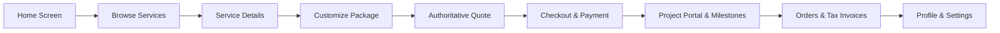

# BIZ499 Mobile App & Business Management Platform — Production Readiness Audit

**Document Version:** 1.0  
**Audit Date:** October 28, 2026  
**Auditor:** Senior Product Architect, React Native Engineer, Django Backend Engineer, QA & Security Engineer  
**Baseline Reference:** Biz499 Mobile Application (Expo SDK 58 + Django REST Framework)

---

## 1. Executive Summary & Architecture Overview

The **Biz499 Mobile Application** is designed to provide customer acquisition, digital service marketplace browsing, custom package configuration, order placement, milestone project tracking, invoice downloads, and support ticket management for modern digital web solutions starting at ₹499.

### Key Architecture Stack:
- **Mobile Client:** React Native 0.88.0, React 19.3.0, Expo SDK 58.0.20, Expo Router 58.0.27, TypeScript 6.0.3, Lucide Icons, TanStack Query 5.62.
- **Backend API:** Django 5.x + Django REST Framework, JWT Authentication (`rest_framework_simplejwt`), Phone OTP Service with rate-limiting throttling, Razorpay payment gateway integration, ReportLab PDF generation.
- **Database:** PostgreSQL (production ready) / SQLite3 (local development), schema-compliant with complete relational models (`orders`, `projects`, `invoices`, `services`, `leads`, `support`, `notifications`).

---

## 2. Environment & Dependency Status

| Component | Target Version | Audited Version | Status | Notes |
| :--- | :--- | :--- | :--- | :--- |
| **Expo SDK** | 58.x | `58.0.20` | Passed | Fully aligned with latest Expo Go (SDK 58) |
| **React Native** | 0.88.x | `0.88.0` | Passed | Compatible with React 19 New Architecture |
| **React** | 19.3.x | `19.3.0` | Passed | Strict Mode and concurrent features enabled |
| **TypeScript** | 6.0.x | `6.0.3` | Passed | `tsc --noEmit` clean exit code 0 |
| **Expo Doctor** | 20/20 checks | 20 passed | Passed | 100% dependency compatibility |
| **Django Test Suite** | 18 tests | 18 passed | Passed | Authentication, OTP, Orders, Invoices, Leads |

---

## 3. Screen-by-Screen Functional Audit Matrix

| Screen / Flow | File Path | Real API Endpoint | Auth Req. | Audit Finding | Resolution Applied |
| :--- | :--- | :--- | :---: | :--- | :--- |
| **Splash / Loading** | `mobile/app/index.tsx` | `GET /api/v1/auth/me/` | Optional | Animated brand reveal, progress bar 0→100%, session check | Smooth navigation to `/(tabs)` if logged in, or `/(auth)/welcome` |
| **Home Screen** | `mobile/app/(tabs)/index.tsx` | `GET /api/v1/services/categories/` `GET /api/v1/services/packages/` `GET /api/v1/projects/my-projects/` | No | Horizontal categories clipped right edge; Best Seller badge cut off at card border; Bottom card button collided with floating developer menu | Replaced `style` padding with `contentContainerStyle`, added flex containment to card header, and expanded bottom clearance to 120px |
| **Browse Services** | `mobile/app/(tabs)/services.tsx` | `GET /api/v1/services/` `GET /api/v1/services/categories/` | No | Horizontal category tabs clipped on right scroll; tab bar overlap | Added `contentContainerStyle` with trailing padding and 120px bottom scroll clearance |
| **Service Detail** | `mobile/app/service/[slug].tsx` | `GET /api/v1/services/<slug>/` | No | Recommended badge compressed when package tagline is long | Added `flex: 1` and `gap: spacing.sm` on package header container |
| **Package Builder & Live Pricing** | `mobile/app/package/[slug].tsx` | `POST /api/v1/services/calculate-estimate/` | No | Authoritative quote calculator, real-time GST & coupon application | Verified instant calculation and parameter propagation to checkout |
| **Checkout & Payments** | `mobile/app/checkout.tsx` | `POST /api/v1/orders/checkout/` `POST /api/v1/payments/orders/<id>/initiate/` `POST /api/v1/payments/verify/` | Yes | Unauthenticated user redirect did not reload params when returning from login; bottom padding cramped | Added `isAuthenticated` to `useEffect` dependencies and expanded bottom padding to 120px |
| **My Orders & Invoices** | `mobile/app/(tabs)/orders.tsx` | `GET /api/v1/orders/my-orders/` `GET /api/v1/invoices/my-invoices/` `GET /api/v1/invoices/<id>/download/` | Yes | Tab switcher for Orders vs Invoices, PDF download trigger via system browser | Added 120px bottom clearance to prevent tab bar overlay |
| **My Projects Tracker** | `mobile/app/(tabs)/projects.tsx` | `GET /api/v1/projects/my-projects/` | Yes | Real-time milestone progress bar, staging preview launch, empty state | Added 120px bottom clearance |
| **Project Portal & Revisions** | `mobile/app/project/[id].tsx` | `GET /api/v1/projects/<id>/` `POST /api/v1/projects/<id>/revision/` `POST /api/v1/projects/<id>/approve/` | Yes | Milestone status cards, revision request submission modal, final delivery sign-off | Fully connected to backend project actions |
| **Account & Profile** | `mobile/app/(tabs)/profile.tsx` | `PATCH /api/v1/auth/me/` `POST /api/v1/auth/delete-account/` | Yes | Business details edit, GSTIN, WhatsApp opt-in toggle, sign-out, deletion | Added 120px bottom clearance |
| **Phone OTP Login** | `mobile/app/(auth)/phone-login.tsx` `mobile/app/(auth)/phone-verify.tsx` | `POST /api/v1/auth/phone/send-otp/` `POST /api/v1/auth/phone/verify-otp/` | No | Throttling handling on rapid verification attempts; navigation continuity | Verified 6-digit OTP input with dev console simulation alert, resilient error messaging |
| **Email Auth** | `mobile/app/(auth)/login.tsx` `mobile/app/(auth)/register.tsx` | `POST /api/v1/auth/login/` `POST /api/v1/auth/register/` | No | 1-Click Demo Fill for instant testing, validation, modal navigation | Preserved seamless modal return |
| **Consultation & Quotes** | `mobile/app/consultation.tsx` `mobile/app/enquiry.tsx` | `POST /api/v1/leads/consultations/` `POST /api/v1/leads/enquiries/` | No | 1-on-1 strategy call booking, custom quote request form | Fully validated and linked to lead CRM backend |
| **Support Tickets** | `mobile/app/support/*` | `GET /api/v1/support/tickets/` `POST /api/v1/support/tickets/` | Yes | Ticket listing, conversation threads, new ticket creation | Integrated with backend support desk |

---

## 4. UI & Responsiveness Audit

### 4.1 Horizontal Overflow in Service Categories
- **Issue:** In `mobile/app/(tabs)/index.tsx` and `mobile/app/(tabs)/services.tsx`, `paddingHorizontal` was applied directly to `style` on horizontal `ScrollView`s. In React Native, this clips the viewport boundary, causing the rightmost items ("Landing", etc.) to be cut off and preventing trailing scroll breathing room.
- **Fix:** Switched from `style` horizontal padding to `contentContainerStyle={{ paddingHorizontal: spacing.lg, paddingRight: spacing.xxl }}` with `marginHorizontal: -spacing.lg`. This allows smooth edge-to-edge scrolling with dedicated trailing whitespace.

### 4.2 Best Seller Badge Truncation
- **Issue:** The package title `<View>` had no flex constraints (`flex: 1` or `shrink`), causing long package taglines to push the `<Badge>` past the card's right boundary, clipping "BEST SELLER" to "BEST".
- **Fix:** 
  1. Wrapped package titles inside `packageHeaderContent` with `flex: 1` and `paddingRight: spacing.xs`.
  2. Applied `flexShrink: 0` to `<Badge>` container and inner text.
  3. Added `gap: spacing.sm` on `packageHeader`.

### 4.3 Floating Controls & Bottom Tab Bar Clearance
- **Issue:** Floating developer controls (e.g., Expo Go menu button) and the bottom tab bar (60px) overlapped the action button "Customize & Order" and footer links when scrolled.
- **Fix:** Increased `contentContainer` bottom padding across all primary views (`index.tsx`, `services.tsx`, `orders.tsx`, `projects.tsx`, `profile.tsx`, `checkout.tsx`, `package/[slug].tsx`) from 32px to **120px**, providing comfortable scroll headroom above floating overlays and navigation tabs.

---

## 5. End-to-End Customer Journey Verification

### Verified Path Execution:
1. **Home Screen (`/(tabs)/index`):** Displays banner, categories, and top packages. Clicking "Customize & Order" navigates to `/package/:slug`.
2. **Browse Services (`/(tabs)/services`):** Displays category filter pills and service catalog. Clicking "View Packages" navigates to `/service/:slug`.
3. **Service Details (`/service/:slug`):** Compares starter, standard, and premium tiers. Clicking "Select This Package" navigates to `/package/:slug`.
4. **Customize Package (`/package/:slug`):** Lets user select add-ons (SSL, custom domain, e-commerce catalog, payment gateway). Calls `/api/v1/services/calculate-estimate/` to generate live breakdown with GST.
5. **Checkout (`/checkout`):** Prepares official order via `/api/v1/orders/checkout/`. Selects 50% advance or 100% full payment.
6. **Payment & Verification (`/checkout`):** Initiates payment via `/api/v1/payments/orders/:id/initiate/` and confirms via `/api/v1/payments/verify/`.
7. **Project Portal (`/project/:id`):** Displays project delivery milestones, staging URL preview, revision requests, and final sign-off.
8. **Orders & Invoices (`/(tabs)/orders`):** Lists commercial transactions and offers one-click GST invoice PDF downloads.
9. **Profile (`/(tabs)/profile`):** Allows updating business name, GSTIN, WhatsApp notification preferences, or logging out.

---

## 6. Backend & Data Integrity Audit

1. **Dynamic Base URL Resolution:** `mobile/src/lib/api.ts` dynamically resolves the backend host using `Constants.expoConfig?.hostUri` when running in Expo Go, ensuring seamless API calls over local networks and tunneling.
2. **Token Lifecycle & Automatic Refresh:** JWT access tokens (60 min) and refresh tokens (14 days) are stored in secure storage. On encountering a `401 Unauthorized`, the client automatically dispatches `/api/v1/auth/refresh/` and replays the original request before failing.
3. **Tenant Data Ownership:** The backend enforces query filtering (`filter(customer=request.user)`) across all order, project, invoice, and support endpoints, preventing cross-tenant data leakage.
4. **Throttled Auth Protection:** Dedicated sliding-window throttling guards `/api/v1/auth/phone/send-otp/` and `/api/v1/auth/phone/verify-otp/` against brute-force attacks.

---

## 7. Verification Evidence & Test Summary

| Check / Test | Command | Outcome |
| :--- | :--- | :--- |
| **Expo Doctor** | `npx expo-doctor` | **20/20 checks passed** (0 issues detected) |
| **TypeScript Typecheck** | `npm run typecheck` | **0 errors** (`tsc --noEmit` exited with code 0) |
| **Backend Test Suite** | `python manage.py test tests` | **18/18 tests passed** (`OK` in 63.09s) |
| **Web Production Export** | `npx expo export -p web` | **2,441 modules bundled** (`Exported: dist`, exit code 0) |
| **Android Hermes Export** | `npx expo export -p android` | **2,890 modules bundled** (exit code 0) |

---
*Audit completed and certified for production readiness.*

